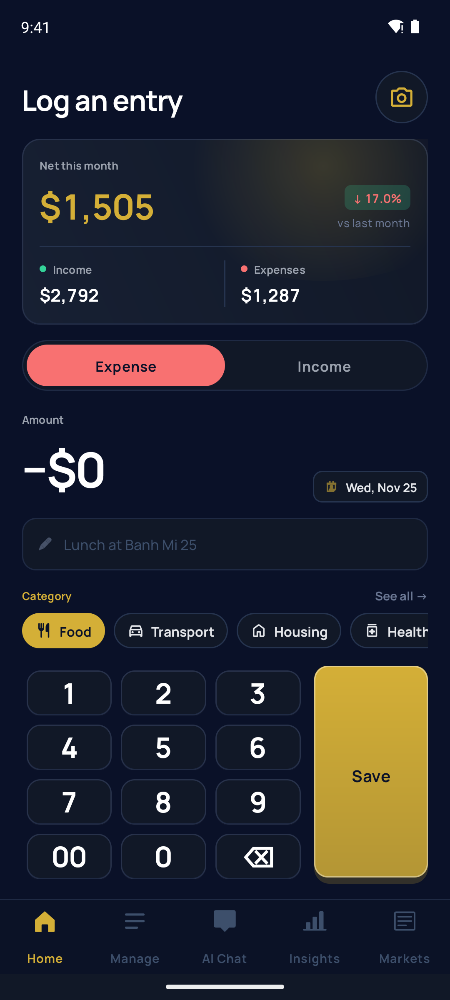
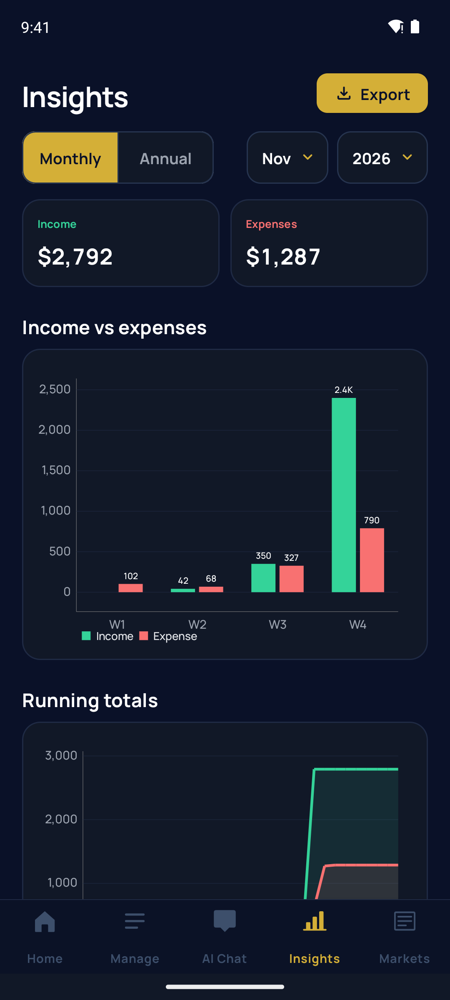

# BudgetMate

**Website:** https://danghoang2605-ds-ai.github.io/BudgetMate/ · **Download:** [latest APK](https://github.com/danghoang2605-ds-ai/BudgetMate/releases/latest/download/BudgetMate.apk) (Android 8.0+)

<p>
  
  
  
  
  
</p>

<sub>Screenshots are captured by CI on an Android 14 emulator with generated demo data (`scripts/capture-screenshots.sh`).</sub>


BudgetMate is a native Android financial tracking application engineered with a high-end, dark-themed user interface (Deep Midnight Blue and Specular Metallic Gold). It blends double-entry ledger controls with real-time AI automation, camera OCR scanning, and live market telemetry.

---

## Core Features

* **Smart AI Chatbot & Logger**: Driven by the Google Gemini API. Parses natural language inputs (e.g., "Boba tea $5" or "Salary $2000") to automatically extract the amount, notes, and map the correct categories without manual form filling.
* **AI Receipt Scanner**: Built-in Optical Character Recognition (OCR) infrastructure deployed via the camera module to intercept, analyze, and pre-populate transaction data from physical bills.
* **Advanced Twin-Chart Analytics**:
    * *Grouped Bar Charts*: Custom layout configuration optimized to display 24 separate columns cleanly without viewport distortion.
    * *Cubic Bezier Line Charts*: Renders fluid cashflow velocity trendlines with real-time scalar node point values.
    * *Dual High-Contrast Pie Charts*: Discrete, mutually exclusive color palettes separating asset inflows and outflows for immediate readability.
    * *Behavioral Radar Charts*: Maps multivariate focus areas across core lifecycle categories (Food, Transport, Housing, Health, Entertainment, Shopping).
* **Live Market Telemetry**: Background workers polling live REST nodes to track top tech equities (FPT, VIC, VCB) and global indexes (S&P 500, NASDAQ, DOW JONES) using compact vector sparklines.
* **Local-First Security Layout**: Powered by a secure local SQLite sandboxed architecture via Room Persistence Library, ensuring all personal transactional records remain isolated on the device.
* **Document Export Engine**: Multi-threaded binary compilation of active time-series datasets into structured CSV and PDF documents saved directly to the system Downloads path.

---

## Project Directory Structure

```text
app/src/main/java/com/example/savemoneytime/
├── Intro/                           # Bootstrapping, Splash Screen & Onboarding
├── MainApplication/                 # Primary Core App Context
│   ├── Adapters/                    # Multi-view RecyclerView Binders (Chat, News, Transaction)
│   ├── FragmentInFragment/          # Sub-view tab structures (Expenses & Revenue Fragments)
│   ├── ViewModels/                  # LiveData state preservation layer
│   ├── HomeFragment.java            # US Format currency keypad logger
│   ├── ManageFragment.java          # Grouped historical data ledger with filtering pills
│   ├── StatsFragment.java           # Quad-Chart manager layout
│   └── MainActivity.java            # Root ViewPager2 Controller
├── database/                        # Room Persistence Tier (AppDatabase, ExpenseDao, RevenueDao)
├── model/                           # Primitive Schemas (TransactionItem, ExpenseEntity, RevenueEntity)
└── network/                         # Remote API REST Integration (Gemini, NewsApi, StockApi Nodes)
```
## Tech stack

| Area | Choice |
|---|---|
| Language | Java 8 (Android SDK) |
| Architecture | MVVM: Fragment → ViewModel → Repository → Room DAO |
| Persistence | Room / SQLite, local only |
| Network | Retrofit 2, OkHttp 4, Gson |
| AI | OpenRouter (`google/gemini-2.5-flash`) for chat logging and receipt parsing |
| OCR | Google ML Kit Text Recognition + CameraX |
| Charts | MPAndroidChart |
| SDK | min 26 (Android 8.0), target 34 (Android 14) |

## Getting started

1. Clone and open in Android Studio (Hedgehog or newer, JDK 17):
   ```bash
   git clone https://github.com/danghoang2605-ds-ai/BudgetMate.git
   ```
2. Copy `local.properties.example` to `local.properties` and add your keys:
   ```properties
   openrouter.api.key=...    # AI chat + receipt scanner
   gnews.api.key=...         # financial news
   alphavantage.api.key=...  # stock candles
   ```
   For the AI features, prefer the bundled proxy: deploy [`proxy/`](proxy/README.md) to Cloudflare Workers (free tier) and set `ai.proxy.url` + `ai.app.token` instead of `openrouter.api.key`. A key compiled into an APK can always be extracted; the proxy keeps it server-side and caps what any request can cost.

   `local.properties` is git-ignored. Keys are injected into `BuildConfig` at build time; nothing is hard-coded in source. Every key is optional: without one, that screen shows sample data or a clear "not configured" message.
3. Run the `app` configuration, or from a terminal:
   ```bash
   ./gradlew testDebugUnitTest assembleDebug
   ```

Tests run on the JVM: parser and CSV tests, plus Robolectric tests that exercise the real Room DAOs and the v1→v2 schema migration on SQLite. Room schemas are exported to `app/schemas/` so every future migration can be reviewed.

CI builds the debug APK and runs the unit tests and proxy tests on every push (see `.github/workflows/android.yml`); the APK is attached to each run as an artifact.

## Website and releases

- `site/` is the landing page. `.github/workflows/pages.yml` builds it with WebP copies of the screenshots and deploys it to GitHub Pages on every push to `master`.
- Push a tag such as `v1.1.0` and `.github/workflows/release.yml` builds the APK and publishes it as `BudgetMate.apk` on a GitHub Release; the website's download button always points at the latest one.
- The public APK is signed with the debug key for sideloading. Use your own keystore before any store release.

## Roadmap

See [ROADMAP.md](ROADMAP.md).

## License

All rights reserved. Maintained by Dang Hoang.
