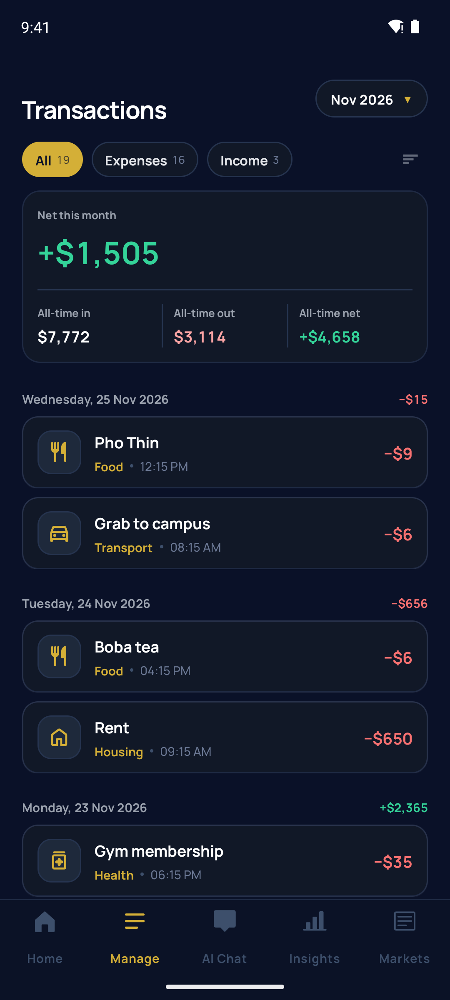
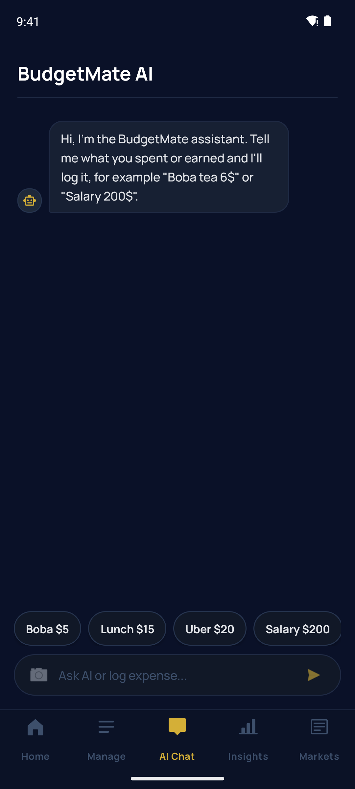
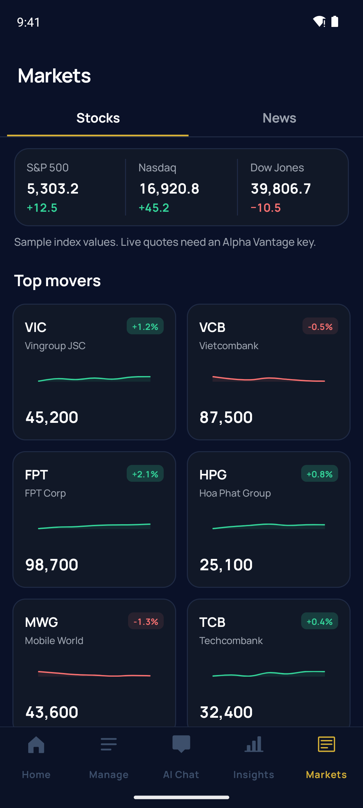

# BudgetMate

**Website:** https://danghoang2605-ds-ai.github.io/BudgetMate/ · **Download:** [latest APK](https://github.com/danghoang2605-ds-ai/BudgetMate/releases/latest/download/BudgetMate.apk) (Android 8.0+)

<p>
  
  
  
  
  
</p>

<sub>Screenshots are captured by CI on an Android 14 emulator with generated demo data (`scripts/capture-screenshots.sh`).</sub>


BudgetMate is an Android expense tracker written in Java. You log spending on a keypad, by typing a sentence to the AI assistant, or by photographing a receipt; everything is stored on the phone in a Room database.

## What it does

- **Keypad logging (Home).** Amount, category, optional note and date, then Save. The month's balance, income and spending sit above the keypad.
- **AI assistant (AI Chat).** "Boba tea 6$" or "Salary 200$" becomes a categorised entry. Replies go through `AiReplyParser`, which copes with fenced JSON and amounts such as `"$6.50"`; questions get a short text answer instead.
- **Receipt scanner.** CameraX plus ML Kit read the receipt on the device, then the model picks out the total. You confirm, edit it on the keypad, or cancel.
- **Insights.** Monthly and annual views: income against spending per period, a running total, spending and income by category, and a radar of the six main spending categories.
- **Export.** CSV and a one-page PDF summary of the selected period, written to the app's Downloads folder.
- **Markets.** Index summary and six Vietnamese large caps (VIC, VCB, FPT, HPG, MWG, TCB) shown with sample prices; tapping one loads daily candles from Alpha Vantage. A News tab lists finance headlines from GNews.
- **Offline by default.** Without API keys the app still works: AI features say they are not configured, and Markets shows its sample data.

## Project structure

```text
app/src/main/java/com/example/savemoneytime/
├── Intro/                 # Splash screen and four-step onboarding
├── MainApplication/       # MainActivity (bottom nav, keeps each tab alive) and the tab fragments
│   ├── Adapters/          # RecyclerView adapters: chat, news, transactions, categories
│   ├── Repository/        # AppRepository: one entry point over both DAOs
│   ├── ViewModels/        # BudgetViewModel (LiveData for every tab)
│   ├── HomeFragment.java     # Keypad logger
│   ├── ManageFragment.java   # Transactions grouped by day, with filters
│   ├── StatsFragment.java    # Charts and CSV/PDF export
│   └── ScannerFragment.java  # Receipt camera + OCR
├── database/              # Room: AppDatabase, ExpenseDao, RevenueDao, Migrations
├── model/                 # Entities and view models for rows
├── network/               # AI (OpenRouter or the proxy), GNews, Alpha Vantage
└── util/                  # AiReplyParser, CSV writer, icons, small helpers (unit-tested)
```

## Tech stack

| Area | Choice |
|---|---|
| Language | Java 8 (Android SDK) |
| Architecture | MVVM: Fragment → ViewModel → Repository → Room DAO |
| Persistence | Room / SQLite, local only |
| Network | Retrofit 2, OkHttp 4, Gson |
| AI | OpenRouter (`google/gemini-2.5-flash`) for chat logging and receipt parsing |
| OCR | Google ML Kit Text Recognition + CameraX |
| Charts | MPAndroidChart |
| SDK | min 26 (Android 8.0), target 34 (Android 14) |

## Getting started

1. Clone and open in Android Studio (Hedgehog or newer, JDK 17):
   ```bash
   git clone https://github.com/danghoang2605-ds-ai/BudgetMate.git
   ```
2. Copy `local.properties.example` to `local.properties` and add your keys:
   ```properties
   openrouter.api.key=...    # AI chat + receipt scanner
   gnews.api.key=...         # financial news
   alphavantage.api.key=...  # stock candles
   ```
   For the AI features, prefer the bundled proxy: deploy [`proxy/`](proxy/README.md) to Cloudflare Workers (free tier) and set `ai.proxy.url` + `ai.app.token` instead of `openrouter.api.key`. A key compiled into an APK can always be extracted; the proxy keeps it server-side and caps what any request can cost.

   `local.properties` is git-ignored. Keys are injected into `BuildConfig` at build time; nothing is hard-coded in source. Every key is optional: without one, that screen shows sample data or a clear "not configured" message.
3. Run the `app` configuration, or from a terminal:
   ```bash
   ./gradlew testDebugUnitTest assembleDebug
   ```

Tests run on the JVM: parser and CSV tests, plus Robolectric tests that exercise the real Room DAOs and the v1→v2 schema migration on SQLite. Room schemas are exported to `app/schemas/` so every future migration can be reviewed.

CI builds the debug APK and runs the unit tests and proxy tests on every push (see `.github/workflows/android.yml`); the APK is attached to each run as an artifact.

## Website and releases

- `site/` is the landing page. `.github/workflows/pages.yml` builds it with WebP copies of the screenshots and deploys it to GitHub Pages on every push to `master`.
- Raise `versionName` (and `versionCode`) in `app/build.gradle` on `master`, or push a tag such as `v1.2.0`: `.github/workflows/release.yml` builds the APK and publishes it as `BudgetMate.apk` on a GitHub Release named after the version. The website's download button always points at the latest one.
- Release APKs are signed with `keystore/sideload.jks`, a deliberately public key that stays the same between releases so updates install over each other. For a private key, add the repository secrets `RELEASE_KEYSTORE_BASE64`, `RELEASE_KEYSTORE_PASSWORD`, `RELEASE_KEY_ALIAS` and `RELEASE_KEY_PASSWORD`; never ship to a store with the public key.
- Online features in the published APK come from repository secrets: `AI_PROXY_URL` and `AI_APP_TOKEN` (AI chat and receipts, see `proxy/`), `GNEWS_API_KEY`, `ALPHAVANTAGE_API_KEY`. Without them the APK works offline and says so.

## Roadmap

See [ROADMAP.md](ROADMAP.md).

## License

All rights reserved. Maintained by Dang Hoang.
